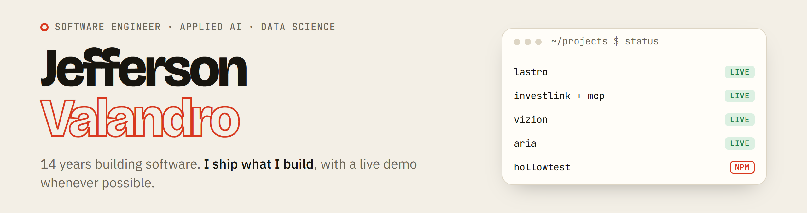

<picture>
  <source media="(prefers-color-scheme: dark)" srcset="assets/banner-dark.png">
  
</picture>

I'm a software engineer from Brazil with a postgraduate degree in Data Science (PUC-Rio). I've spent 14 years on backend and full-stack systems for fintech, logistics and education, and these days I bring AI into real products. Almost everything below has a demo you can open right now.

**[jeffersonvalandro.com.br](https://jeffersonvalandro.com.br/en/)** · [LinkedIn](https://www.linkedin.com/in/jeffersonvalandro) · [Kaggle](https://www.kaggle.com/jeffersonvalandro) · 🇧🇷 [em português](https://jeffersonvalandro.com.br/)

### 🟢 In production

| Project | What it does | Stack | |
|---|---|---|---|
| **Lastro** | CRM for real estate agencies. An AI assistant proposes actions and the agent confirms them. | FastAPI · PostgreSQL (RLS) · React PWA · Claude | [demo](https://lastro.jeffersonvalandro.com.br) |
| **[InvestLink](https://github.com/jeffev/Investlink)** | Stock and REIT screener for the Brazilian market with an explainable score, built on audited CVM filings. | Flask · React · PostgreSQL · pandas | [demo](https://investlink.jeffersonvalandro.com.br) |
| **InvestLink MCP** | MCP server with RAG (pgvector + EmbeddingGemma on CPU) and read-only SQL. The demo shows every tool call live. | Python · MCP · pgvector · Gemini | [demo](https://investlink.jeffersonvalandro.com.br/mcp-demo/en) |
| **Vizion** | BI without SQL: ask in plain language, get charts and dashboards grounded in real queries. | Next.js · FastAPI · DuckDB · Claude | [demo](https://vizion.jeffersonvalandro.com.br) |
| **[ARIA](https://github.com/jeffev/aria)** | Personal assistant that turns text or voice into events, tasks and notes through function calling. | Next.js · Prisma · Gemini · PWA | [demo](https://aria.jeffersonvalandro.com.br) |
| **[Tradelink](https://github.com/jeffev/tradelink)** | Trade journal and multi-indicator backtesting engine with an async job queue. | React · NestJS · FastAPI · BullMQ | [demo](https://tradelink.jeffersonvalandro.com.br) |

### 🧪 Open source

- **[hollowtest](https://github.com/jeffev/hollowtest)**: finds tests that pass even when the code is broken (no assertions, `toBeNull` without `()`, asserts that only run in `catch`, unawaited `.resolves`). JS, TS and Python, on [npm](https://www.npmjs.com/package/hollowtest), with an ESLint plugin and a Claude Code plugin. [Try it in the browser →](https://jeffev.github.io/hollowtest/)
- **[swing-quant](https://github.com/jeffev/swing-quant)**: quantitative swing-trading system validated with walk-forward and Monte Carlo, plus a [16-year study](https://jeffev.github.io/swing-quant/) on whether it beat simply investing.
- **[archlens-ai](https://github.com/jeffev/archlens-ai)**: points at a codebase and generates an interactive architecture report with health scores and dependency cycles.
- **[ai-dev-kit](https://github.com/jeffev/ai-dev-kit)**: spec-driven workflow, quality auditor and hooks to set up AI coding agents in any project.
- **[promptlab](https://github.com/jeffev/promptlab)**: test your prompts like code.
- **[kairo-blocks-lite](https://github.com/jeffev/kairo-blocks-lite)**: 10 free landing-page blocks for Next.js 16, Tailwind CSS 4 and shadcn/ui. [Demo](https://kairo-blocks-lite.jeffev123.workers.dev)

### 📚 Books

- **[Artificial Intelligence from the Inside](https://www.amazon.com/dp/B0HNR1GLTG)**: from predictive systems to LLMs and Transformers. Paperback on Amazon, also [in Portuguese on Kindle](https://www.amazon.com.br/dp/B0HNRQNJYL).
- **[How to Pass Developer Interviews](https://www.amazon.com/dp/B0HNRC5JSP)**: from the résumé to the offer. Paperback on Amazon.
- Free PDFs, including *Your First MCP Server* and a children's book on how AI works: [jeffersonvalandro.com.br/en/books](https://jeffersonvalandro.com.br/en/books/)

### 🧩 Templates

Production-ready Next.js 16 + Tailwind CSS 4 + shadcn/ui templates under the **ValandroUI** name: an admin dashboard, an AI SaaS starter, invoicing, booking, directory, real estate and more, each with a live demo. [See them all →](https://jeffersonvalandro.com.br/en/products/)

---

Java · Spring Boot · Python · FastAPI · TypeScript · React · Next.js · PostgreSQL · Docker · LLMs (Claude, Gemini) · RAG · MCP
